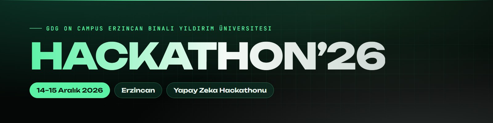
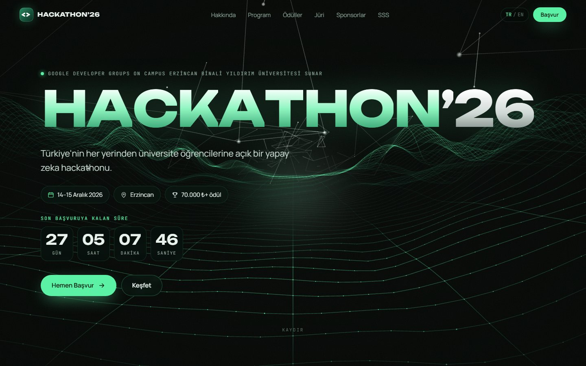
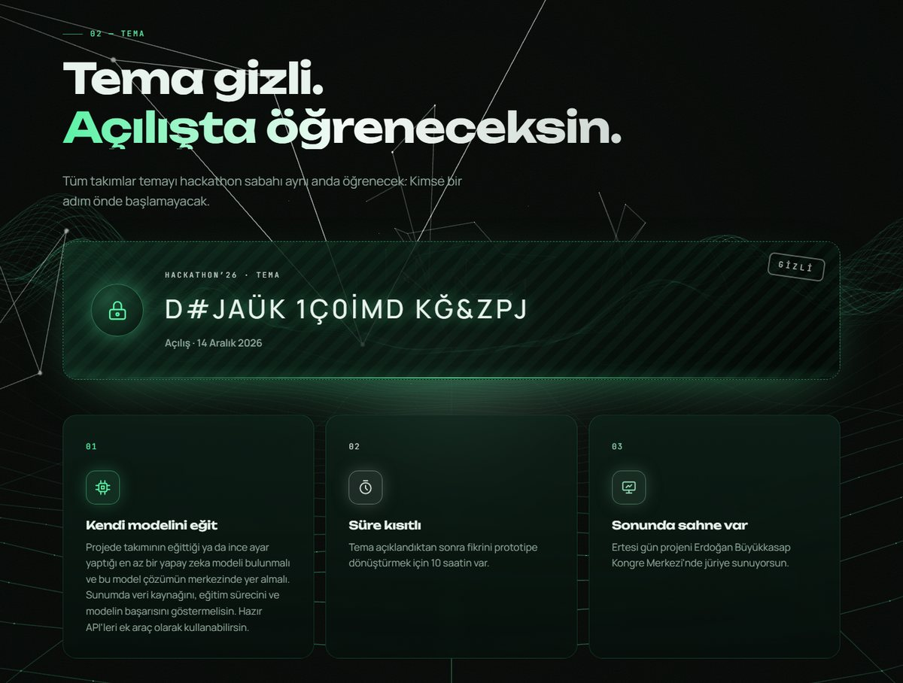
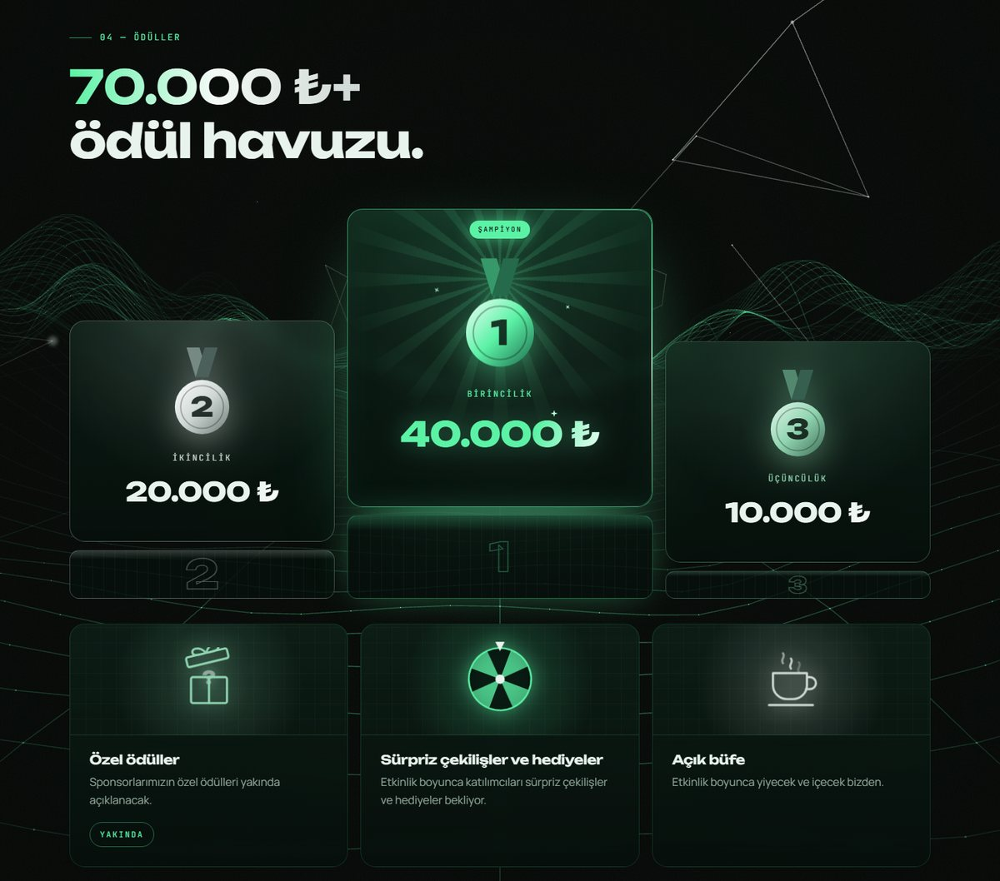
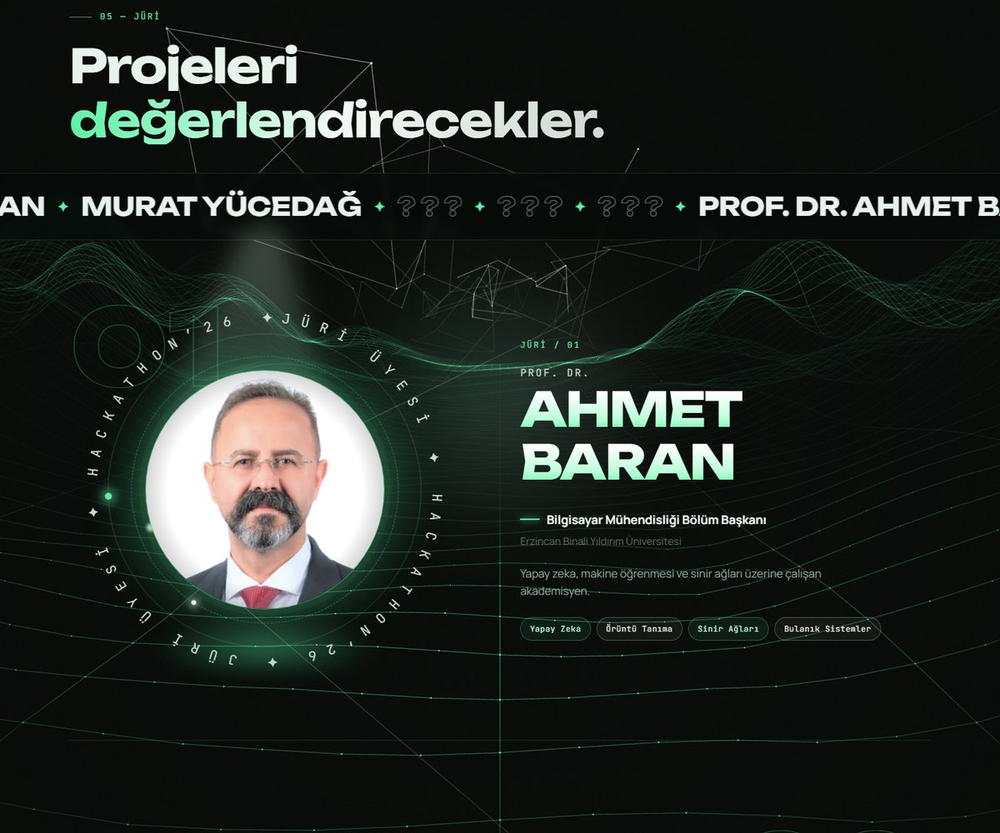
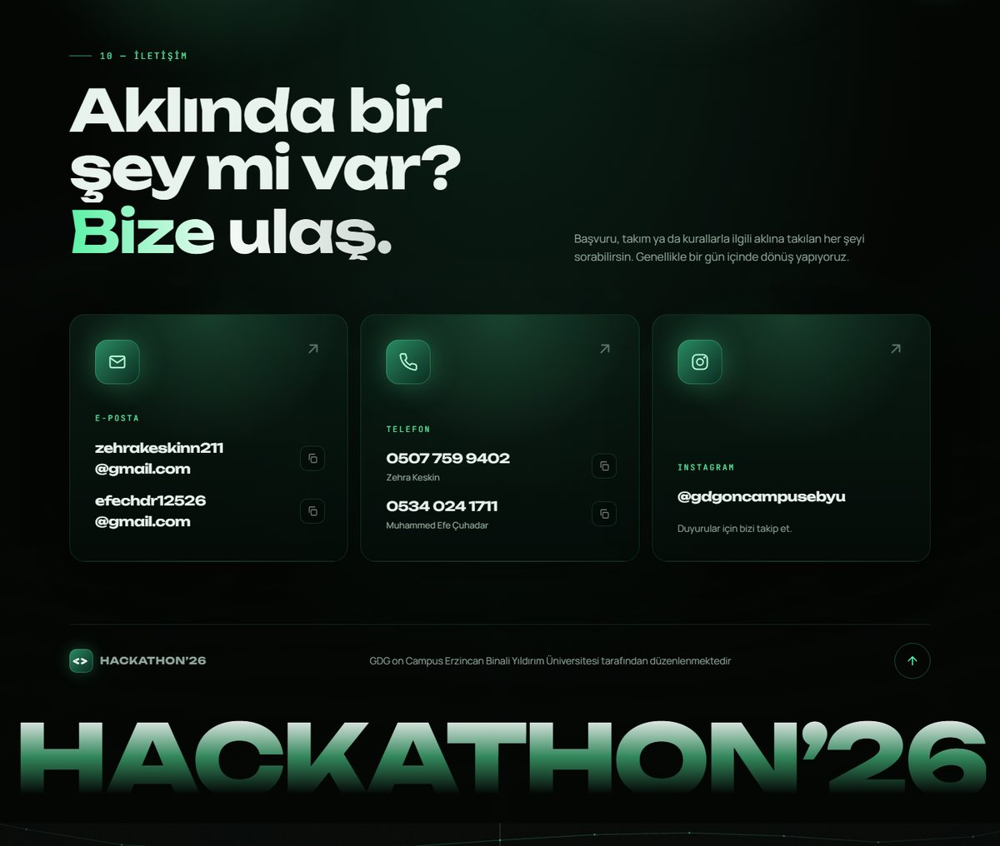
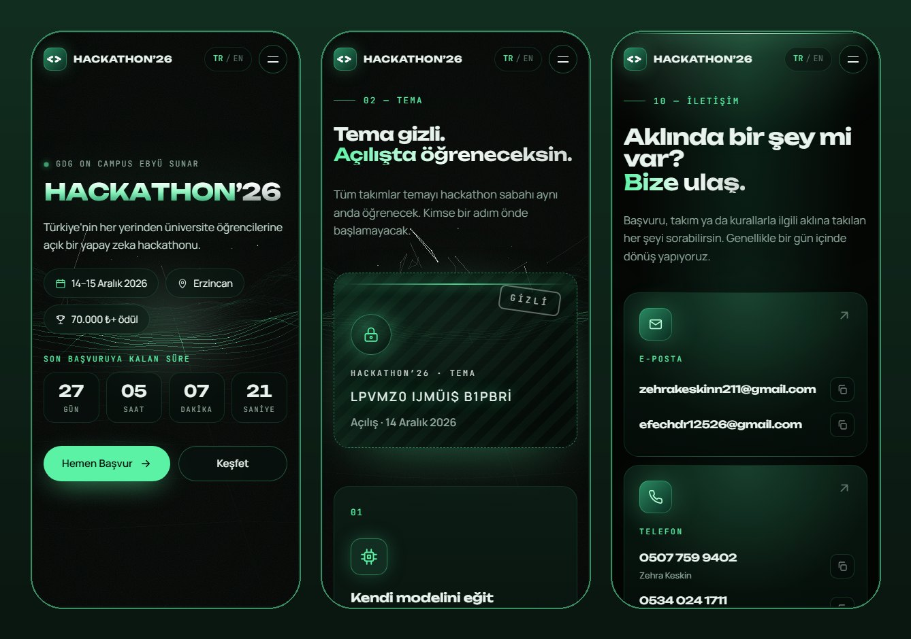

<p align="center">
  
</p>

<p align="center">
  <a href="https://busrayanal.github.io/hackathon26/"></a>
  
  
</p>

<p align="center">
  <a href="#turkce"><b>Türkçe</b></a> · <a href="#english"><b>English</b></a>
</p>

<p align="center">
  
</p>

---

<a id="turkce"></a>

## Türkçe

**Hackathon’26**, Google Developer Groups on Campus Erzincan Binali Yıldırım Üniversitesi'nin düzenlediği yapay zeka hackathonunun tanıtım sitesi. Etkinlik 14–15 Aralık 2026'da Erzincan'da; ilk gün Milli Teknoloji Atölyesi'nde 10 saatlik geliştirme, ikinci gün Erdoğan Büyükkasap Kongre Merkezi'nde sunumlar ve ödül töreni.

🔗 **Canlı site:** [busrayanal.github.io/hackathon26](https://busrayanal.github.io/hackathon26/)

### Öne çıkanlar

- **3D arka plan:** Three.js ile çizilen, imleçle ve kaydırmayla hareket eden dalga ve ağ sahnesi
- **Geri sayım:** Son başvuruya, başvurular kapanınca etkinliğe kalan süreyi gösterir
- **Gizli tema ve jüri kartları:** Sürekli karışan harfler, radar taraması ve sansürlü satırlarla açıklanmayı bekleyen içerik
- **Ödül podyumu:** Dönen ışıklı kenarlar ve parlayan madalyalar
- **Sponsorluk paneli:** E-posta ve telefonların kopyalanabildiği açılır pencere
- **Türkçe / İngilizce:** Sayfa yenilenmeden dil değiştirme
- **Mobil uyumlu:** Telefonda ayrı düzenlenmiş kartlar ve kaydırılabilir program akışı
- **Kolay güncelleme:** Tüm içerik tek bir dosyada (`js/data.js`)

### Ekran görüntüleri

| Tema | Ödüller |
|:---:|:---:|
|  |  |
| **Jüri** | **İletişim** |
|  |  |

<p align="center"><b>Mobil</b></p>
<p align="center"></p>

### Kullanılan teknolojiler

| | |
|---|---|
| Yapı | HTML, CSS, saf JavaScript (derleme adımı yok) |
| 3D sahne | [Three.js](https://threejs.org/) |
| Animasyon | [GSAP](https://gsap.com/) + ScrollTrigger |
| Yumuşak kaydırma | [Lenis](https://lenis.darkroom.engineering/) |
| Yazı tipleri | Unbounded, Manrope, JetBrains Mono |
| Yayın | GitHub Pages |

### Klasör yapısı

```
├── index.html        Sayfanın iskeleti
├── css/style.css     Tüm stiller
├── js/
│   ├── data.js       Düzenlenebilir içerik (buradan güncellenir)
│   ├── main.js       Bölümleri oluşturma, dil, animasyonlar
│   └── scene.js      3D arka plan
├── assets/           Logolar, jüri fotoğrafları, görseller
└── docs/             README görselleri
```

### İçeriği güncellemek

Sitedeki değişken bilgilerin hepsi `js/data.js` dosyasında. Her metnin `tr` ve `en` olmak üzere iki sürümü var; bir metni değiştirirken ikisini de güncelle.

| Alan | Ne işe yarar |
|---|---|
| `formUrl` | Başvuru formunun linki. Boşsa buton "Başvurular Yakında Açılıyor" yazar. |
| `applyDeadline` | Son başvuru anı (`"2026-11-30T23:59:00+03:00"`). Sayaç buna sayar, geçince buton "Başvurular Kapandı" olur. |
| `eventStart` | Etkinliğin başlangıcı. |
| `emails`, `phones`, `instagram` | İletişim bilgileri. Numaraya `name` eklenirse altında kime ait olduğu görünür. |
| `jury` | Jüri üyeleri. Henüz açıklanmayan üye için `{}` bırakılır, gizli kart görünür. Fotoğraf `assets/jury/` içine konur. |
| `sponsors` | Sponsorlar. `logo` boşsa isim yazıyla gösterilir. |
| `partners` | Ana sayfadaki kayan logo şeridi. |
| `schedule`, `faq` | Program akışı ve sık sorulan sorular. |

### Bilgisayarda açmak

`index.html` dosyasını tarayıcıda açman yeterli. Kütüphaneler CDN'den yüklendiği için internet bağlantısı gerekiyor.

### Yayınlamak

Site GitHub Pages ile `main` dalının kök klasöründen yayınlanıyor; `main`'e gönderilen her değişiklik 1–2 dakika içinde canlıya çıkar. Kendi alan adını bağlamak için **Settings → Pages → Custom domain** alanına domaini yazıp alan adı sağlayıcısında GitHub'ın gösterdiği DNS kayıtlarını eklemek yeterli.

---

<a id="english"></a>

## English

**Hackathon’26** is the website of an AI hackathon organized by Google Developer Groups on Campus Erzincan Binali Yıldırım University. The event takes place in Erzincan, Türkiye on December 14–15, 2026: ten hours of building at the National Technology Workshop on day one, then presentations and the award ceremony at Erdoğan Büyükkasap Congress Center on day two.

🔗 **Live site:** [busrayanal.github.io/hackathon26](https://busrayanal.github.io/hackathon26/)

### Highlights

- **3D background:** A Three.js wave and network scene that reacts to the cursor and scrolling
- **Countdown:** Counts down to the application deadline, then to the event itself
- **Secret theme and jury cards:** Scrambling letters, a radar sweep and redacted lines for content not yet revealed
- **Prize podium:** Rotating glowing borders and shining medals
- **Sponsorship panel:** A dialog with copyable emails and phone numbers
- **Turkish / English:** Switch languages without reloading the page
- **Mobile friendly:** Cards re-laid out for phones and a swipeable schedule
- **Easy to update:** All content lives in a single file (`js/data.js`)

### Screenshots

| Theme | Prizes |
|:---:|:---:|
|  |  |
| **Jury** | **Contact** |
|  |  |

<p align="center"><b>Mobile</b></p>
<p align="center"></p>

### Tech stack

| | |
|---|---|
| Structure | HTML, CSS, vanilla JavaScript (no build step) |
| 3D scene | [Three.js](https://threejs.org/) |
| Animation | [GSAP](https://gsap.com/) + ScrollTrigger |
| Smooth scrolling | [Lenis](https://lenis.darkroom.engineering/) |
| Fonts | Unbounded, Manrope, JetBrains Mono |
| Hosting | GitHub Pages |

### Project structure

```
├── index.html        Page skeleton
├── css/style.css     All styles
├── js/
│   ├── data.js       Editable content (update the site here)
│   ├── main.js       Section rendering, language switch, animations
│   └── scene.js      3D background
├── assets/           Logos, jury photos, images
└── docs/             README images
```

### Updating the content

Everything that changes lives in `js/data.js`. Each text has a `tr` and an `en` version; update both when editing.

| Field | Purpose |
|---|---|
| `formUrl` | Link to the application form. When empty, the button reads "Applications Opening Soon". |
| `applyDeadline` | Application deadline (`"2026-11-30T23:59:00+03:00"`). The countdown targets it; afterwards the button switches to "Applications Closed". |
| `eventStart` | Event start time. |
| `emails`, `phones`, `instagram` | Contact details. Adding `name` to a phone number shows whose number it is. |
| `jury` | Jury members. Leave `{}` for a member not yet announced to show a secret card. Photos go in `assets/jury/`. |
| `sponsors` | Sponsors. Without a `logo`, the name is shown as text. |
| `partners` | The scrolling logo strip on the home page. |
| `schedule`, `faq` | Event schedule and frequently asked questions. |

### Running locally

Open `index.html` in a browser. Libraries are loaded from a CDN, so an internet connection is required.

### Deployment

The site is served by GitHub Pages from the root of the `main` branch; every push to `main` goes live within a minute or two. To use a custom domain, enter it under **Settings → Pages → Custom domain** and add the DNS records GitHub shows at your domain provider.

---

<p align="center">
  <sub>Google Developer Groups on Campus · Erzincan Binali Yıldırım Üniversitesi</sub>
</p>
